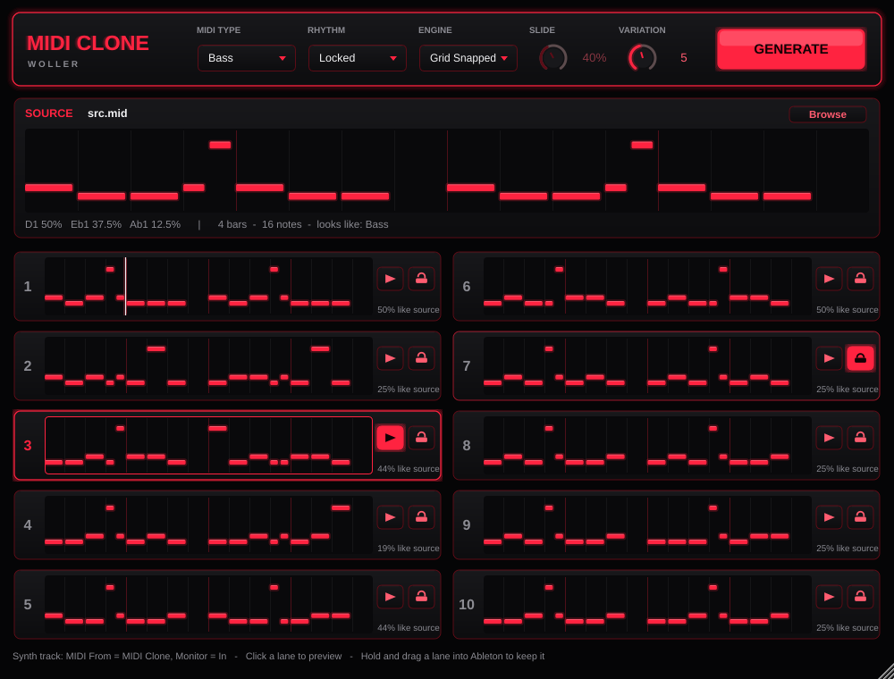

# MIDI Clone (WOLLER) — Phase 1

Drop in a MIDI clip (bass, melody or arp). MIDI Clone measures which notes it uses and how often, then makes **10 new clips** with the same note percentages, the same length and the same rhythmic feel. Preview any of them through your own synth, lock the ones you like, and drag the keeper into Ableton.



## How it works

- **Note formula.** The source's notes and their shares are kept exactly. For example, D 50% / Eb 37.5% / Ab 12.5% stays D 50% / Eb 37.5% / Ab 12.5% in every clone. Clones only use notes from the source, so nothing goes higher or lower than your clip.
- **Same length and phrase.** A 4-bar clip gives 4-bar clones. If your clip repeats a 2-bar phrase, the clones repeat a phrase too, with a small change the second time through.
- **Different enough.** Each clone is checked against your clip and against the other lanes, and near-copies are regenerated. "x% like source" on each lane shows how many notes land on the same step and note as your clip.

## Controls

| Control | What it does |
|---|---|
| **MIDI Type** | Bass, Melody / Lead or Arp / Pluck. Picked automatically when you load a clip, and you can change it. Each type sets its own rhythm default and rules. Bass keeps the home note on the beat and the high note as a short hit. Melody moves smoothly and resolves home. Arp keeps the pattern moving. |
| **Rhythm** | **Locked:** your exact rhythm with the notes reshuffled. **Same Feel:** a new rhythm made from the same note lengths. |
| **Engine** | **Grid Snapped:** clean steps. **Slide:** some notes overlap the next one so a synth with glide/portamento slides between them. |
| **Slide** | How many notes glide (Slide mode only). |
| **Variation** | 1 = close to your clip, 10 = far from it. |
| **Generate** | Makes 10 new clips. Locked lanes are kept. |
| **Lane: play button** (or click the lane) | Sends that lane's MIDI out. Only one lane plays at a time, and switching waits for the next bar line. |
| **Lane: lock** | Keeps the lane when you press Generate. |
| **Lane: drag** | Hold on a lane and drag it onto a track or clip slot in Ableton to keep it as a normal MIDI clip. |

## Set it up in Ableton

1. Put **MIDI Clone** on a MIDI track (Plug-Ins → WOLLER → MIDI Clone). It makes no sound itself.
2. On your synth track (for example Serum 2), set **MIDI From** to the MIDI Clone track and choose **MIDI Clone** in the box under it. Set **Monitor** to **In**.
3. Drop a .mid file onto MIDI Clone's window, or click **Browse**.
4. Press **Generate**, then click lanes to hear them on your synth. Preview follows Ableton's transport; when Ableton is stopped it plays on its own at the set tempo.
5. To keep a lane, drag it onto your synth track (or record the synth track while it previews).

MIDI Clone and its 10 lanes are saved with your Ableton set.

## Get the Mac plugin (GitHub build)

1. Create a new **private** GitHub repository, for example `MidiClone`.
2. Upload everything in this folder (`Source`, `Tools`, `CMakeLists.txt`, `README.md`, `screenshot.png`). The hidden `.github` folder often gets skipped by the browser: add it with **Add file → Create new file**, named `.github/workflows/build.yml`, and paste in the contents of `build.yml`.
3. Open the **Actions** tab and wait for the green check (about 10 minutes).
4. Download **MidiClone-macOS**, unzip it, then double-click **MidiClone-VST3-mac.zip**. If the artifact download fails, the same zip is under **Code → Releases**.
5. Move **MIDI Clone.vst3** into `~/Library/Audio/Plug-Ins/VST3/`, then in Terminal:
   ```
   xattr -cr ~/Library/Audio/Plug-Ins/VST3/"MIDI Clone.vst3"
   ```
6. In Ableton: **Settings → Plug-Ins**, hold **Option** and click **Rescan**. It appears under **Plug-Ins → WOLLER → MIDI Clone**, next to White Noise and Ground Shake.

The build is universal (Apple Silicon and Intel). It's VST3 only, because Audio Units can't send MIDI to other tracks in Ableton.

## Build locally

Requires CMake 3.22+ and a C++17 compiler (Xcode on Mac). JUCE downloads automatically.

```
cmake -B build -DCMAKE_BUILD_TYPE=Release
cmake --build build --config Release
```

Optional test tool: `-DMC_BUILD_TESTS=ON` builds `MidiCloneTest`. Run `MidiCloneTest clip.mid outfolder`: it generates clones, checks the note percentages, range, length and uniqueness, checks lock behaviour, runs the MIDI output against a fake 140 BPM transport (timing and the switch on the bar line), checks saving and reopening, and saves a screenshot.

## Phase 2 ideas

Chords type, a "More like this lane" button, key and scale change, alternative notes per role, matching by playing time, presets, and an optional Max for Live helper that writes clips directly.

## Licence note

Built with JUCE (AGPLv3 or JUCE's commercial licences). Fine for personal use; check JUCE's licence before selling it.
